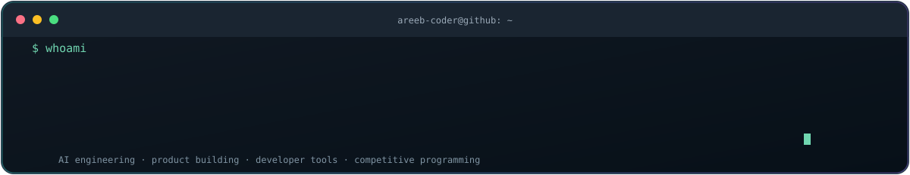
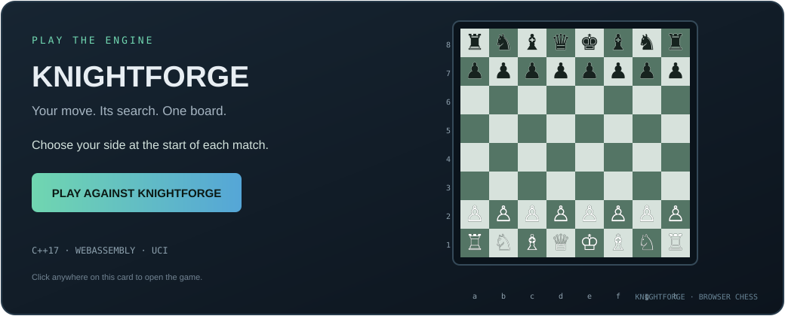

---

## The city I built this year

  

Every building represents a day of contributions; taller buildings mean more activity. The city is generated from public GitHub contribution data.

## Hey, I'm areeb-coder 👋

  

I'm a **B.Tech Computer Science & Data Science student at Jamia Millia Islamia**, interested in building practical software across AI, developer tools, automation, and intelligent systems.

- Building AI-assisted products and developer experiences.
- Exploring algorithms, C++ systems, chess programming, and competitive agents as individual projects.
- Interested in clean architecture, reproducible testing, and useful automation.
- I enjoy taking an idea from concept → architecture → prototype → iteration.

> I build things to perfection and pitch them even better.

## Developer toolkit

### Languages

  

### Frameworks & application development

  

### Engineering & developer tools

  

### AI & data ecosystem

`OpenAI` · `Gemini` · `Claude` · `Hugging Face` · `Roboflow` · `Google Vision` · `NumPy` · `Pandas` · `Matplotlib`

### Problem solving

  
  
  
  

### Connect

  

## Featured projects

<table>
  <tr>
    <td width="50%" valign="top">
      <h3><a href="https://github.com/Areeb-coder/loreline-ai">LORELINE</a></h3>
      
AI-powered engineering intelligence for exploring codebases, dependencies, code search, and the Git history behind implementation decisions.

      TypeScript · AI · Developer Tools
    </td>
    <td width="50%" valign="top">
      <h3><a href="https://github.com/Areeb-coder/KnightForge">KnightForge</a></h3>
      
A C++17 chess-engine project featuring legal move generation, SAN, classical search, UCI support, and a browser-playable WebAssembly build.

      C++ · Search · Chess · WebAssembly
    </td>
  </tr>
  <tr>
    <td width="50%" valign="top">
      <h3><a href="https://github.com/Areeb-coder/botmatchmaker">Battlecode tooling</a></h3>
      
Competitive-agent tooling and experiments around match workflows, evaluation, and iterative bot development.

      C++ · Automation · Game Agents
    </td>
    <td width="50%" valign="top">
      <h3><a href="https://github.com/Areeb-coder/NewsTrace">NewsTrace</a></h3>
      
A news-focused application with a public web demo.

      Python · <a href="https://news-trace-pearl.vercel.app">Live demo</a>
    </td>
  </tr>
  <tr>
    <td width="50%" valign="top">
      <h3><a href="https://github.com/Areeb-coder/whatsapp-summarizer">WhatsApp Summarizer</a></h3>
      
Turns long chat histories into concise, easier-to-scan summaries.

      Python · Summarization
    </td>
    <td width="50%" valign="top">
      <h3><a href="https://github.com/Areeb-coder/piper-chess-club">Piper Chess Club</a></h3>
      
A digital home for chess-club events, activities, and community updates.

      Web Development · Community
    </td>
  </tr>
</table>

## Play against KnightForge ♟️

  

**Choose your side and make your moves.** The opponent is the KnightForge C++ engine compiled to WebAssembly—not a third-party bot. The board flips when you choose Black, and KnightForge makes the opening move for you.

- [Play against KnightForge](https://areeb-coder.github.io/KnightForge/)
- [Explore the engine source](https://github.com/Areeb-coder/KnightForge)

The board above is a clickable preview because GitHub profile READMEs display images but do not run embedded JavaScript games. GitHub Pages must be enabled in KnightForge for the live game URL to publish.

## What I'm exploring next

- More reliable AI-powered developer workflows.
- Better chess-engine search and reproducible playing-strength benchmarks.
- Competitive agents that adapt to opponents and game environments.
- Stronger software architecture, testing, and end-to-end product delivery.

**Thanks for stopping by.**

[Explore all repositories →](https://github.com/Areeb-coder?tab=repositories)

